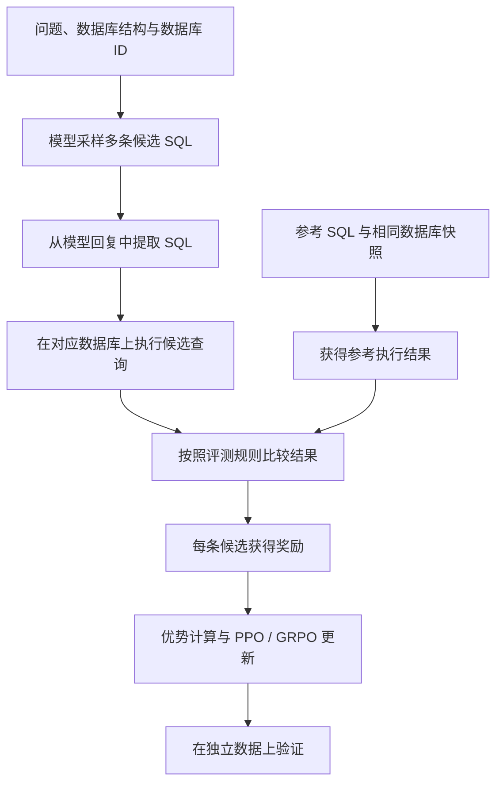

# Search-R1 SQL 执行奖励训练方案

本文整理如何把现有的检索问答训练迁移为自然语言生成 SQL（Text-to-SQL）训练，并加入 SQL 执行奖励。

**核心思路：模型根据问题和数据库结构生成 SQL，在对应数据库上执行，根据查询结果是否正确获得奖励，再用 PPO／GRPO 更新模型。** 问题、参考 SQL 和数据库使用现成公开数据，无需从零人工构造训练集。

本文是设计方案。第 0 节是 2026-10-21 收敛后的执行范围，第 9 节是 25 天排期。当前仓库尚未实现 SQL 数据转换、SQL 执行评分和训练入口；本轮按第 6 节自建最小训练循环，不改造仓库内的 `verl`。

需要获取数据时，可直接查看[第 2.4 节：数据集下载链接](#24-数据集下载链接)。

## 0. 本轮范围与交付（2026-10-21 决定）

目标：**2026-11-15 前**交付一个可运行、可复现、能讲清楚的闭环，作为日常实习简历项目。以下决定优先于本文其余章节的原始设想。

| 项 | 决定 | 理由 |
| --- | --- | --- |
| 数据集 | **Spider 1.0 主用**（已下载并解压）；**BIRD dev 作跨数据集测试**；BIRD train 备用 | Spider 库小、跑得快，主链路用它；BIRD 只做外部对照 |
| 数据划分 | **按 `db_id` 隔离 test/val，按题隔离 SFT/RL**：test=Spider dev 1,034，val=20 库 866 题，SFT 4,859 / RL 1,262（120 库） | 已切分并校验重叠为 0；详见 2.5 |
| 数据清洗 | gold 可执行、schema 对齐、去重、prompt ≤3,072、单条 SQL | 实测：train 去重 10、gold 失败 3；test 0 失败 |
| 任务形态 | **先单轮、后多轮**：v1 单轮生成（问题 + schema → 一条 SQL）；v2 在 v1 跑通后加“执行反馈 → 改一版” | 单轮保证 25 天交付；多轮复用同一套奖励与训练器，只加一层状态机 |
| 实现顺序 | **v1 闭环 → 奖励审计 → v2 多轮（gate 通过才做）** | 先把可验证的链路做扎实，再用 2 天换“执行反馈是否有用”的对照 |
| 训练框架 | **自建最小 GRPO 循环**：PyTorch DDP + LoRA + HuggingFace `generate` | 昇腾适配成本最低；SQL 输出短，HF 生成足够，不必引入 vLLM／verl 的版本风险 |
| 模型 | Qwen2.5-3B-Instruct + LoRA（r=16） | 单卡可训，8×910B4 显存余量充足 |
| 硬件 | 华为云 8×910B4（32GB）：1 卡开发、8 卡训练 | 已有代金券；预计总训练卡时 < 20 个八卡小时 |
| 主实验 | base → SFT → SFT+GRPO；v1 出主结果与审计，v2 作为加分对照 | 25 天内可完成的最小可信证据链 |
| 本轮不做 | CSpider、schema 检索、Test Suite 多实例、verl 集成 | 任何一项都会让 25 天超期 |

第 6 节保留原“改造 verl”方案作为背景与备选：只有在 10/22 的 Gate 中 `vllm-ascend` 与 `verl` 能稳定跑通时才考虑，不作为默认路径。

## 1. 训练任务是什么

模型接收自然语言问题和可查询的数据库结构，输出能够完成查询的 SQL。训练的是语言模型生成 SQL 的能力，数据库作为执行与验证环境使用。

例如，下面是帮助理解流程的示意，不是需要人工编写的训练样本：

```text
问题：工资超过 10000 的员工有多少人？
数据库结构：employees(id, name, salary)
参考 SQL：SELECT COUNT(*) FROM employees WHERE salary > 10000;
数据库文件：company.sqlite
```

模型看到问题及结构后，可以生成：

```sql
SELECT COUNT(*) FROM employees WHERE salary > 10000;
```

训练系统执行这条 SQL，并与参考查询的结果比较。参考 SQL 和标准结果用于评分，不能直接暴露给模型作为该题的输入。

第一版先完成“一次生成 → 执行评分 → RL 更新”。后续再引入表结构检索，以及执行失败后的多轮自我修复。

## 2. 对应的数据集包含什么

完整的可执行 SQL 训练数据需要四部分：

| 资源 | 含义 | 使用位置 |
| --- | --- | --- |
| 自然语言问题 | 用户想查询什么 | 模型输入 |
| 数据库结构（schema） | 表名、列名、类型、主键、外键等 | 第一版直接放入模型输入，后续可检索 |
| 参考 SQL（gold） | 数据集已有的正确查询 | SFT 监督或 RL 评分，不作为待评估模型的输入 |
| 实际数据库 | 含表结构和数据的 SQLite 等数据库文件 | 预测查询与参考查询的执行环境 |

只有“问题—SQL”文本对还不足以计算执行奖励，必须同时取得相匹配的数据库文件。数据库中的业务表数据也不等于问答训练样本，两者通过 `db_id` 关联。

### 2.0 本轮实际使用的数据（清单）

**主用 Spider，BIRD 只做跨数据集测试。**

| 角色 | 数据集 / 文件 | 规模 | 状态 |
| --- | --- | --- | --- |
| **Test（冻结）** | Spider dev（`spider_data.zip` 内 `dev.json` + `database/`） | 1,034 题 / 20 库 | 已切分 `test.jsonl` |
| **Val** | Spider train 留出 20 库 | 866 题 | 已切分 `val.jsonl` |
| **SFT** | Spider train 其余 120 库的 80% | 4,859 题 | 已切分 `sft.jsonl` |
| **RL** | 同 120 库剩余 20% | 1,262 题 | 已切分 `rl.jsonl` |
| 跨数据集测试 | BIRD dev `dev.zip` | 1,534 题 / 11 库 | 已下载；200 条基线 25.5% |
| 备用 | BIRD train `train.zip` | 8.3 GB / 69 库 | 已下载，未解压 |
| 不用 | BIRD filtered、CSpider、Test Suite、SIX-GYM、`train_others.json`、Spider `test.json` | — | — |

文件位置：`~/work/sqlrl/data/raw/spider_data.zip`（解压后 1.8 GB）、`~/work/sqlrl/data/processed/spider/`。

### 2.1 Spider 1.0（主用，已下载）

Spider 提供跨领域问题、参考 SQL、数据库结构与 SQLite 数据库，适合建立执行奖励基线。作者公布的总体规模为 10,181 个问题、200 个数据库，包含不同划分，不能全部作为训练集。[Spider 官方页面](https://yale-lily.github.io/spider)

本轮主用：`spider_data.zip` 已下载并解压到 `data/raw/spider_extract/spider_data/`。

字段注意：`train_spider.json` / `dev.json` 中的 **`query` 是 SQL 字符串**，`sql` 是解析后的结构体；数据库路径为 `database/{db_id}/{db_id}.sqlite`。

获取完整数据包后，通常需要读取以下资源：

| 文件或目录 | 内容 |
| --- | --- |
| `train_spider.json` | 训练问题、参考 SQL 与数据库 ID |
| `dev.json` | 开发评估样本 |
| `tables.json` | 数据库表、列与主外键等结构信息 |
| `database/` | 对应 SQLite 数据库文件 |

实际目录层级以下载版本为准。应先核对问题、schema 和数据库的 `db_id` 能否对应，再批量转换数据。

### 2.2 CSpider（不使用）

本轮不做中文，不使用 CSpider。

### 2.3 BIRD（跨数据集测试）

BIRD 只用于跨数据集测试：用 dev 1,534 题 / 11 库评估 Spider 训练出的模型；`train.zip`（9,428 题 / 69 库）留作备用，不进入主实验。

过滤版 `bird23-train-filtered` 只有标注、没有数据库，不用。

### 2.4 下载入口（备查）

- Spider 1.0：`spider_data.zip`（Google Drive，已下载到 `data/raw/`）
- BIRD dev：https://bird-bench.oss-cn-beijing.aliyuncs.com/dev.zip
- BIRD train：https://bird-bench.oss-cn-beijing.aliyuncs.com/train.zip

其余数据集（CSpider、Test Suite、SIX-GYM）本轮不用。

### 2.5 数据划分与清洗（当前执行口径）

#### 划分

| 用途 | Spider 1.0（主用） | BIRD（跨数据集测试） | 规则 |
| --- | --- | --- | --- |
| Test | dev 1,034 题 / 20 库 | dev 1,534 题 / 11 库 | 冻结，只做最终评测 |
| Val | train 留 20 库，866 题 | — | 按 `db_id` 留出，选 checkpoint |
| SFT | 其余 120 库的 80%，4,859 题 | — | 按题切分 |
| RL | 同 120 库剩余 20%，1,262 题 | — | 与 SFT 题目不重叠 |

- **Test/Val 按库隔离**：val 与训练库不重叠，避免“同 schema 选模”偏乐观；Spider 官方 train/dev 的 `db_id` 本身不重叠，dev 可直接作为跨库 test。
- **SFT/RL 按题隔离、库共享**：RL 面对“同库新题”，衡量题目级泛化；若 RL 用未见库，会把 schema 泛化与奖励学习混在一起。
- **去重**：按 `(db_id, 归一化 question)` 去重后再切分。
- **BIRD**：只做跨数据集测试，不参与切分。

#### 清洗

1. **gold 可执行性**：候选超时 5s、gold 超时 10s；不可执行的样本记录原因并剔除。Spider 实测：train 7,000 条中 3 条失败、test 0 条；BIRD 200 条 199/200。
2. **schema 对齐**：以 sqlite introspection 为准；不一致的库单独记录。Spider 有 3 个库不一致（`soccer_1`、`store_1`、`world_1`），保留但标记；BIRD 0%。
3. **prompt 长度**：训练上限 3,072 token；超长丢弃并统计。Spider 实测 p50 344、p95 1,123、max 2,930，全部在 3,072 内；BIRD p95 2,357。
4. **去重与空题**：空问题、重复问题、gold 为空串的样本剔除。
5. **单条语句**：`gold` 指数据集自带的参考 SQL（BIRD 的 `SQL` 字段、Spider 的 `sql` 字段），用于生成参考执行结果。
   - 候选是多语句：记 `multi_statement`，该样本奖励 0；
   - `gold` 本身是多语句：样本定义有问题，直接剔除，不参与训练/评测（不是奖励 0）；
   - 末尾分号、字符串内的分号、`WITH ... SELECT`、`UNION` 都算单条。
6. **只读快照**：`mode=ro&immutable=1`，禁止 `PRAGMA`/`ATTACH`/写操作与 `CREATE TEMP TABLE`。

清洗产物：`data/processed/spider/{test,val,sft,rl}.jsonl` 与 `split_report.json`；每条含 `id`、`db_id`、`db_path`、`question`、`gold_sql`、`prompt`、`prompt_tokens`、`schema_mismatch`，训练集后续另写 Parquet。

## 3. 一轮 RL 训练怎样运行



1. **读取一批问题。** 每条样本带有对应数据库 ID、schema 和评分所需的参考 SQL。
2. **生成候选。** 模型对同一道题采样多个答案；每个答案包含一条最终 SQL。
3. **执行查询。** 评分器定位对应数据库，执行候选查询，记录结果、错误或超时。
4. **计算奖励。** 按相同评测规则比较候选结果和参考结果，得到数值奖励。
5. **更新模型。** 奖励进入自建 GRPO 的优势计算与策略更新流程。SQL 执行不参与反向传播；它提供供 RL 使用的反馈。
6. **验证与记录。** 在未参与参数更新的数据上报告执行正确率和成本。

例如，对前面的工资查询，假设采样得到：

| 候选 SQL | 假设执行情况 | 初始奖励 |
| --- | --- | ---: |
| `SELECT COUNT(*) FROM employees WHERE salary > 10000;` | 与参考结果一致 | 1 |
| `SELECT COUNT(*) FROM employees;` | 得到全部员工数，与参考结果不同 | 0 |
| `SELECT COUNT(*) FROM employees WHERE income > 10000;` | `income` 列不存在，执行失败 | 0 |

这里的结果差异取决于具体数据库；评分器实际执行后才能确定奖励。不能仅根据 SQL 的外观预先判分。

GRPO 使用同题候选之间的奖励差异估计优势。若同组候选全部失败或全部成功，组内奖励缺少差异，对该组的相对学习信号会较弱。因此先检查初始模型是否具备部分成功能力，必要时用已有参考 SQL 做 SFT，再开展 RL。

## 4. 执行奖励如何设计

第一版采用简单的终局奖励：

| 情况 | 奖励 |
| --- | ---: |
| 输出有效 SQL，成功执行，结果与参考结果按既定规则一致 | 1 |
| SQL 有效且能执行，但结果不同 | 0 |
| 没有有效 SQL、执行错误或超时 | 0 |

训练时在上述奖励之上再叠加三条否决规则，防止模型用“结果碰巧相等”骗分：

| 规则 | 判定条件 | 处理 |
| --- | --- | --- |
| 常量答案 | 候选 SQL 不含 `FROM`，而参考 SQL 含 `FROM` | 奖励记 0，单独计数 |
| 空结果对空结果 | 两侧结果集都为空 | **不否决**，记 info；单独报告“含/不含空结果”两套 EX |
| 解析或执行异常 | SQL 提取失败、超时、数据库错误 | 奖励记 0，单独计数，不计入模型错误率 |

审计时把三类单独统计，并同时报告“含偶然命中”与“剔除偶然命中”两套执行正确率；两者的差距本身就是本项目的核心结论之一。

**“能执行”是有效性指标，不能代替正确性奖励。** 合法查询仍可能漏掉条件、选错表或算错聚合。也不应直接用当前 `qa_em.py` 对 SQL 字符串做相等比较，不同 SQL 写法可能得到相同结果。

对结果的比较要统一处理排序、重复行、NULL、浮点和空结果，采用所选数据集对应版本的评测约定。Spider 可参考 [Test Suite 官方评测实现](https://github.com/taoyds/test-suite-sql-eval)，BIRD 则对齐对应版本的官方执行评测器。

两条查询在一个数据库上返回相同结果，仍可能只是偶然，例如两者都返回空结果。测试套件或多个数据实例能减少此类误判，不能把单次执行相等当作完整语义证明。

第一版只处理查询任务，使用只读执行环境并设置超时、资源限制。参考查询结果可以预计算和缓存，但缓存必须绑定数据库快照、参考 SQL 和评测版本。基础设施故障、丢失数据库等问题应单独记录，不能一律混成“模型答错”。

## 5. 如何转换成当前 Search-R1 的数据格式

参考现有 [nq_search.py](../Search-R1/scripts/data_process/nq_search.py) 新增 SQL 处理脚本，自动读取公开数据并生成 Parquet；本轮自建训练循环直接读取同一份 Parquet，字段约定不变。建议样本结构如下，字段值仍以示意查询为例：

```json
{
  "data_source": "spider_sql",
  "prompt": [{
    "role": "user",
    "content": "数据库结构：employees(id INTEGER, name TEXT, salary REAL)。请生成查询SQL，在<answer>与</answer>之间输出最终SQL。问题：工资超过10000的员工有多少人？"
  }],
  "ability": "text-to-sql",
  "reward_model": {
    "style": "rule",
    "ground_truth": {
      "db_id": "company",
      "reference_sql": "SELECT COUNT(*) FROM employees WHERE salary > 10000;"
    }
  },
  "extra_info": {
    "split": "train",
    "index": 10001
  }
}
```

`spider_sql`、`reference_sql` 等是拟新增的业务约定，当前 BIRD 构建使用 `bird_sql`；两者都不是现有评分器已识别的字段。实际执行器通过受控的 `db_id → 数据库路径` 映射定位文件；模型不能自行指定任意本地数据库路径。

`extra_info.index` 在合并后的数据中保持唯一。问题与结构放入 `prompt`，参考 SQL 留在 `ground_truth`。SQL 数据集已有的解析树、标记序列等字段可按需要保留，不必全部转换为模型输入。

## 6. 实现路径：先单轮，后多轮

本轮不修改 `verl`，在仓库根目录新建 `sqlrl/`。整体分三层：**环境与评分层 → 轨迹层 → 训练层**。v1 只用前两层加一次生成；v2 在中间加一个 agent 状态机，训练层完全不变。

```text
v1:  数据 → 单轮 rollout → 执行评分 → GRPO → 评测
                                   │
                             (gate 通过)
                                   ↓
v2:  数据 → 多轮 rollout（agent loop）→ 同一评分 → 同一 GRPO → 对比评测
```

### 6.1 v1：单轮生成（必须，先做完）

严格按下面顺序实现，每一步都能单独验证，不要跳步：

1. **数据**：`build_spider.py` 读 `train_spider.json` / `dev.json` / `tables.json`，与 sqlite 实际 schema 对齐，输出 Parquet，字段含 `prompt`、`reward_model.ground_truth.{db_id, reference_sql}`、`extra_info.index`。
2. **环境**：`sqlite_exec.py` 用只读 URI（`mode=ro&immutable=1`）打开库，`set_progress_handler` 做查询级超时，结果归一化（排序、NULL、浮点、重复行）。
3. **评分**：`exec_reward.py` 从回复提取 SQL → 执行 → 与参考结果比较 → 三条否决规则。
4. **Rollout**：`hf_rollout.py` 一次 `generate`，同题 `n=8`。
5. **训练**：`grpo.py` 组内优势、token 级奖励、KL、动态采样。
6. **评测**：`eval_dev.py` 输出 EX、有效执行率、pass@8、maj@8。
7. **审计**：常量 SQL、空对空、单行命中的比例，单独报告。

v1 的协议（无状态，最简单）：

```text
问题 + 完整 schema  →  <answer> SELECT ... </answer>
```

执行发生在**训练侧**，不在轨迹里；模型看不到执行错误。这是 25 天能交付的前提。

### 6.2 v2：多轮执行反馈（gate 通过后才做）

v2 新增 `agent/` 下三个文件和一个合成数据脚本，数据、环境、评分、训练、评测全部复用 v1。协议扩成三段：

```text
<sql> SELECT ... </sql>            # 动作：请求执行
<observation> ... </observation>   # 系统注入，不参与 loss
<answer> SELECT ... </answer>      # 终止：提交最终 SQL
```

状态机：

```text
state = prompt
for t in range(max_turns=3):
    out = generate(state, stop=["</sql>", "</answer>"])
    out = 补全闭合标签                       # 截断后补 </sql> 或 </answer>
    state += out                            # loss_mask = 1
    act = parse_action(out)                 # 正则：<(sql|answer)>(.*?)</\1>
    if act == answer: break
    if act == sql:
        obs = execute(act.sql)              # 只读、超时、行数上限
        state += "<observation>" + obs + "</observation>"   # loss_mask = 0
    else:
        state += 非法动作提示                 # loss_mask = 0；连续两次非法则终止
```

伪代码里 `max_turns=3` 是上限；首版按第 7 节要求用 `max_turns=2`（首轮 + 一次重写）。

五条硬规则：

- **只有模型生成的 token 参与 loss**；prompt 与 observation 的 `loss_mask=0`。这是多轮 RL 最容易写错的地方。
- 观测必须截断（建议 128 token，中间截断，保留错误开头和结尾），单条轨迹总长上限 2,048。
- 终止条件：`<answer>`、连续两次非法动作、达到 `max_turns`；已终止的轨迹不再生成（active mask）。
- 观测只返回候选 SQL 的执行错误或结果，**不得包含参考 SQL 或参考结果**。
- 中间轮执行成功不给正确性分，避免“反复执行刷分”。

v2 的奖励：

```text
R = 1.0   最终 <answer> 执行结果与参考一致
  - 0.02 * (n_turns - 1)      # 轮数惩罚
  + 0.05   格式完整（标签闭合、有 answer）
  = 0     连续两次非法 / 超时 / 无 answer / 命中否决规则
```

多轮冷启动：`synth_repair.py` 把 gold SQL 人为改坏（删 WHERE、改列名、漏 JOIN），在真实库上执行拿报错，生成“错误 SQL → 错误信息 → gold 修复”的轨迹；SFT 时同样只对模型 token 算 loss，观测部分 mask 掉。这样不需要强模型也能造出多轮数据。

### 6.3 轨迹契约（v1 与 v2 共用）

```python
@dataclass
class Turn:
    start: int
    end: int
    kind: str           # "model" | "observation"
    action: str | None  # "sql" | "answer" | "invalid"

@dataclass
class Trajectory:
    input_ids: Tensor
    loss_mask: Tensor      # 1=模型 token, 0=prompt/observation
    turns: list[Turn]
    final_sql: str | None
    n_turns: int
    tool_errors: list[str]
    reward: float
```

GRPO 仍按 `Trajectory` 分组：同一 prompt 的 `n` 条轨迹为一组，标量奖励广播到 `loss_mask=1` 的 token，KL 同理。v1 的轨迹只有一轮（`n_turns=1`），结构与 v2 完全一致——这样 v2 不需要改训练器。

### 6.4 与 Search-R1 的复用边界

| 复用方式 | 内容 |
| --- | --- |
| **可复用（设计）** | 标签协议、停止符截断后补闭合标签、观测注入、观测 mask、`max_turns`、active mask 提前退出 |
| **不可复用（代码）** | `search_r1/llm_agent/generation.py` 绑死旧版 `verl.DataProto`、`actor_rollout_wg.generate_sequences` 与同步 worker；当前 verl 0.8 已改为异步 HTTP agent loop |
| **可选（框架）** | verl 0.8 的 `ToolAgentLoop` + `BaseTool`，但要求 Hermes tool-call 格式与 SFT，25 天内不建议接 |

### 6.5 模块划分

| 文件 | 职责 | 版本 |
| --- | --- | --- |
| `sqlrl/data/build_spider.py` | Spider → Parquet | v1 |
| `sqlrl/env/sqlite_exec.py` | 只读执行、超时、归一化 | v1 |
| `sqlrl/reward/exec_reward.py` | 提取、比对、否决规则、错误分类 | v1 |
| `sqlrl/rollout/hf_rollout.py` | 单轮批量生成 | v1 |
| `sqlrl/train/grpo.py` | DDP + LoRA GRPO | v1 |
| `sqlrl/eval/eval_dev.py` | EX / pass@8 / McNemar | v1 |
| `sqlrl/agent/protocol.py` | 标签、停止符、动作解析 | v2 |
| `sqlrl/agent/loop.py` | 多轮状态机 | v2 |
| `sqlrl/agent/trajectory.py` | 轨迹数据结构 | v2（v1 也用它） |
| `sqlrl/data/synth_repair.py` | gold SQL 改坏 → 合成修复轨迹 | v2 |

**关键实现点（两版共用）：**

- 奖励写在最后有效 token；v2 中就是 `<answer>` 的最后 token。
- 优势按同题分组计算：同一 prompt 的 `n=8` 条候选为一组，组内减均值、除标准差；零方差组直接丢弃（动态采样），不产生梯度。
- 参考策略用“关闭 LoRA adapter 的同一个 base”，不额外占显存；KL 系数 0.001。
- 每步记录：平均奖励、零方差组比例、可执行率、SQL 提取失败率。**第 20 步平均奖励仍低于 0.05 时停止训练**，回查提取器或改用拒绝采样微调。

**备选路线（仅当 10/22 的 Gate 通过）：** 若 `vllm-ascend` + 上游 `verl` 能稳定跑通，可改用框架实现；此时必须处理两个已验证的坑：

- `qa_em.py` 的 `extract_solution()` 在 `<answer>` 只出现一次时返回 `None`（`len(matches) <= 1`）。SQL 提示词若不含示例标签，模型正常输出单标签会导致**奖励恒为 0 且不报错**。
- 无搜索分支的 `uid` 在 `n_agent` 复制之后、`rollout.n` 复制之前赋值；若照搬搜索脚本的 `n_agent=5` 而未设 `rollout.n`，每组只有 1 条样本，GRPO 退化为无中心化的 REINFORCE。正确配置是 `n_agent=1`、`rollout.n=8`。

## 7. 阶段边界与 gate

| 阶段 | 模型如何工作 | 开发内容 | 状态 |
| --- | --- | --- | --- |
| **v1：单轮 SQL 生成 + 执行奖励** | 一次生成最终 SQL，训练侧执行评分 | 数据、评分、单轮 rollout、GRPO | **必做，11/5 前完成** |
| **v1.5：奖励审计** | 不训练，只统计 | 常量 SQL、空对空、单行命中 | 必做，11/9 前完成 |
| **v2：执行反馈 + 多轮修复** | 生成 SQL → 执行 → 读错误 → 改一版 | `agent/` 状态机、观测 mask、合成修复数据 | **gate 通过后 2 天** |
| 阶段二：schema 检索 | 先查表结构再生成 SQL | schema 索引、按库过滤 | 本轮不做 |

### 7.1 v2 的三级 gate（11/9 判定）

**Gate 只决定“要不要建”，不决定“建了有没有用”；后者由 E 组实验回答，不能用“单轮 RL 不涨”反过来当开工条件。**

**G0 工程与证据（三条全过）**

1. C 组（SFT+GRPO）已跑完，dev EX 可复现（同一 checkpoint 重跑差异 <1 个点）；
2. 审计表已出：硬作弊率、空对空率、单行命中率都有数；
3. 11/6–11/9 没有欠账（评测、成本表、图表都完成）。

**G1 科学前提（在 SFT/RL 后的 checkpoint 上评估，1 天内完成）**

1. 失败样本中“可执行但报错”的占比 ≥25%，且其中列名/语法类 ≥60%；
2. 提示式修复 pilot：取 200 条失败样本，把执行错误回传，让同一个模型改一次（不训练），EX 提升 ≥3 个点。

**G2 预算与数据**

1. 至少留 2 天 + 20 个八卡小时；
2. `synth_repair` 能产出 ≥500 条格式正确、可执行的修复轨迹；
3. 预注册评测口径：同一批 200 条 dev 子集，C vs E 配对比较，报 EX、平均轮数、每轨迹 token。

**kill 条件：** G1 的 pilot 提升 <1 个点，直接放弃 v2，不做 RL 多轮。

任一 gate 不过就停在 v1，把多轮写进“后续工作”，不影响交付。

### 7.2 如果单轮 RL 不涨：先归因，再决定

| 现象 | 更可能的原因 | 正确动作 | 多轮有用吗 |
| --- | --- | --- | --- |
| 组内全 0 多、奖励稀疏 | 数据太难 / 冷启动不足 | 课程学习、更多 SFT、RFT | 否，会更难 |
| 训练奖励涨、独立 EX 不涨 | reward hacking | 审计、加否决规则 | 否 |
| 失败以“能执行但结果错”为主 | schema linking / 逻辑 | schema 检索、补数据 | 有限 |
| 失败以列名、语法错误为主 | 执行反馈可修 | 多轮 | **是** |
| 模型容量不够 | 3B 上限 | 换 7B / 蒸馏 | 否 |

多轮是 fallback 的**最后一项**，不是第一选择。先修奖励、数据、冷启动，再谈交互轮数。

### 7.3 v2 实验设计（gate 通过后）

- 只做 C vs E：都从 C 的 checkpoint 出发，E 加 `max_turns=2`，同一批 200 条，配对 McNemar；
- 报三个数：EX 增量、平均轮数、每轨迹 token 成本；
- 负结果也写：E 不涨时结论是“执行反馈在该 checkpoint 上无增益”；
- 不进入主结论：主结论仍是 v1 的 SFT→RL，多轮作为加分章节。

**v2 的最小实现**：`max_turns=2`（首轮 + 一次重写），只回传错误类型和错误位置，不回传参考结果；先在 200 条子集上验证，再决定是否全量。

**为什么必须先把单轮做完**：单轮已经能验证“奖励可信、训练有效、评测可复现”三条链路；多轮只增加状态机，不改变奖励定义。先做多轮会把 25 天耗在调试状态机上，而且没有单轮基线就无法判断多轮是否真的带来提升。

阶段二涉及的检索接口没有显式数据库过滤，容易检索到其他库的 schema，本轮不碰。

## 8. 实验与分析计划

### 8.0 基线（已完成）

**Spider 切分（2026-10-21）：** sft 4,859 / rl 1,262 / val 866 / test 1,034；库数 120/120/20/20；重叠检查全部为 0（val vs train、test vs train、sft vs rl）；train 去重 10 条、gold 执行失败 3 条，test 0 失败。详见 `data/processed/spider/split_report.json`。

**未训练基线（BIRD dev 200，跨数据集）：**

| 指标 | 数值 |
| --- | --- |
| 提取成功 | 100% |
| 有效执行率 | 60.0% |
| EX | 25.5%（simple 33.0% / moderate 18.2% / challenging 5.3%） |
| 硬作弊 | 0 |
| 单样本耗时 | 2.96 s |

错误分布：`no_such_column` 53、`syntax_error` 14、`no_such_function` 8、截断/多语句 3。审计发现 `single_row_both` 39 条是标量答案的正常现象，不能当作弊，已降级为 info。完整报告见 `~/work/sqlrl/reports/base_eval_200_report.md`。

**Spider dev 200 条分层基线（2026-10-22）：** EX 51.5%（103/200）、可执行 86.0%、提取 99.5%、gold 100%；错误：`no_such_column` 25、`no_such_function` 1、`no_such_table` 1、`extract_missing` 1；硬作弊 0，`empty_both` 9 条、`single_row_both` 56 条只记 info；2.07 s/样本，总 413 s。日志 `logs/spider_base200_20261022_002701.log`，逐样本记录 `reports/spider_base200.jsonl`。

> 修正说明：初版把 7 条“裸 SQL + 多余 `</answer>`”误判为 `multi_statement`；修复提取器（剥离游离标签）后这些样本正常执行，指标以 `spider_base200_recomputed.json` 为准。真正的多语句输出为 **0 条**。

**SFT 冷启动（2026-10-22）：** 4,859 条（max_len=2,048 后 4,794），299 步 / 31.3 min，峰值 21.6 GB，loss 1.86→0.14；val_200 EX 70.0%、可执行 93.0%；rl_100 pass@8 87.0%、平均正确 4.78/8、混合组 57.0%、全对 30.0%、全 0 13.0%、可执行 84.9% → **满足 GRPO 前提**（混合组 ≥40%、平均 2–6），可执行率需监控。详见 `~/work/sqlrl/docs/run_sft.md`。

### 8.1 先验证数据和评分器

BIRD dev 200 条已逐项检查；Spider 侧由 `split_report.json` 覆盖 gold/schema/长度检查，实测：

1. schema 与 sqlite 一致：BIRD 100%；Spider 有 3 个库不一致（`soccer_1`、`store_1`、`world_1`），保留并标记。
2. gold 可执行：BIRD 199/200；Spider train 3/7,000 失败、test 0 失败。
3. prompt 长度：Spider p50 344 / p95 1,123 / max 2,930；BIRD p50 707 / p95 2,357。
4. 提取：100%（`<answer>`/`<sql>`/未闭合/fenced/裸 SQL 五级 fallback）。
5. 同一候选在相同快照下评分可复现（BIRD 200 条重算结果一致）。

这一步只用现成标签，不构造新数据。

### 8.2 对照设计

| 实验 | 设置 | 回答的问题 |
| --- | --- | --- |
| A：base | Qwen2.5-3B-Instruct 零样本，固定 schema 与输出协议 | 起点在哪？ |
| B：SFT | Spider 训练集参考 SQL，LoRA 1 epoch | 模仿带来多少提升？ |
| C：SFT + GRPO | 从 B 的同一检查点出发，执行奖励，n=8，200 步 | RL 的增量是多少？ |
| D：奖励审计 | 对 A／B／C 的候选做常量 SQL、空结果、单行结果的命中统计 | 奖励是否被“碰巧相等”污染？ |
| E：v2 多轮（可选） | 从 C 的检查点出发，`max_turns=2`，同一批 200 条 dev 子集 | 执行反馈带来多少提升？代价是几轮、多少 token？ |

C 必须从 B 的检查点出发，才能把 RL 的增量与 SFT 分开。dev 只用于评测，调参从训练集内部划出；不得混入 dev 或 test 的答案。E 只在 v2 gate 通过后做，并且必须与 C 在同一批 200 条子集上配对比较，否则无法区分“多轮收益”和“评测样本差异”。

### 8.3 指标与统计

| 指标 | 含义 |
| --- | --- |
| 执行正确率（EX） | 结果集与参考一致 |
| 剔除偶然命中的 EX | 去掉常量答案、空对空、单行偶然命中后的正确率 |
| 有效执行率 | 能执行的比例，与 EX 分开报告 |
| pass@8 / maj@8 | 采样分布是否变好，pass@1 不变时尤其重要 |
| 配对检验 | 同一批 dev 题上 B 与 C 的 McNemar 检验 |
| 错误类型迁移 | JOIN、过滤、聚合、排序、NULL、重复行 |
| 平均轮数 | 仅 v2：每条轨迹完成所需轮数，与准确率一起看 |
| 工具错误类型 | 仅 v2：语法、列名、表名、超时，用于定位修复收益来源 |
| 每轨迹 token 成本 | v1 与 v2 的生成成本对比 |
| 成本 | 每步生成 token、评分耗时、端到端时延 |

**不要只报总 EX。** 1,034 条 dev 上 2 个点的差异处在噪声边缘；用配对 McNemar 检验加上错误类型迁移，才能支撑“RL 带来提升”的结论。至少跑 2 个 seed，或在同一 seed 下报告 dev 评测的重复采样均值。

### 8.4 风险与备选

| 风险 | 触发条件 | 应对 |
| --- | --- | --- |
| 昇腾环境不可用 | 换镜像或升级依赖后 | 回退到已验证镜像；HF `generate` 兜底 |
| 奖励静默全 0 | 第 20 步平均奖励 <0.05 | 回查提取器与标签；补 SFT；改用拒绝采样微调 |
| RL 无增益 | C 与 B 差异不显著 | 交付“审计 + 负结果”叙事，并补 RFT 对照 |
| 时间不足 | 11/8 仍未完成评测 | 砍掉第二 seed 与延伸实验，保核心四张表 |

Plan B 的记录方式：RL 不涨也是完整项目——“Spider 上 SFT 后 RL 增益有限，我定位到原因是奖励稀疏／标签噪声／分布饱和”，并给出 RFT 对照。Plan C：把 GRPO 换成拒绝采样微调，几乎必然优于 SFT，仍属后训练范畴。

## 9. 25 天排期（2026-10-21 至 2026-11-15）

| 日期 | 任务 | 门槛／产出 |
| --- | --- | --- |
| 10/21–10/22 | **昇腾 Gate**：1 卡跑通 `torch_npu` + transformers + peft，3B 生成 + 一步 LoRA 反传 | 不通则切 HF 生成或租 4090；当晚定路线 |
| 10/23–10/24 | Spider 已解压并切分（test/val/sft/rl）；生成 Parquet；统计长度、截断率、gold 可执行率 | 切分报告无重叠，gold 可执行率 >95% |
| 10/25 | 执行评分器 + 200 条人工核对；端到端 smoke（100 题 × 10 步） | 奖励分布不是全 0 或全 1 |
| 10/26–10/27 | base 模型 dev 评测；奖励审计 v1（常量／空结果／单行） | 审计表初版 |
| 10/28–10/30 | SFT：LoRA r=16，1 epoch，约 7,000 条 | dev EX 明显高于 base |
| 10/31–11/01 | SFT 评测；配对分析与错误分类脚本 | 基线锁定，可算 McNemar |
| 11/02–11/05 | v1 GRPO：200 步，n=8，动态采样丢弃零方差组 | 训练曲线 + 首个 RL 数字 |
| 11/06–11/07 | v1 评测：EX、pass@8、maj@8、McNemar、错误迁移；**11/06 开始投递** | 核心结果四张表 |
| 11/08–11/09 | 审计收尾、成本表、图表；**G0/G1/G2 判定**（含 200 条提示式修复 pilot） | 审计表 + gate 结论 + pilot 数字 |
| 11/10–11/11 | v2 多轮（G1 pilot ≥3 点才做）或 第二 seed／RFT（否则） | 多轮对照 或 稳健性证据 |
| 11/12–11/13 | repo 整理、README、2 篇博客 | 可验证产出 |
| 11/14–11/15 | 简历定稿 + buffer | 可投递 |

**截至 2026-10-22 的进度：** 昇腾 Gate、Spider 切分、BIRD/Spider 200 条基线、SFT 冷启动（val EX 70.0%、pass@8 87.0%）均已完成；GRPO 200 步已完成（4 卡、96.5 min、峰值 11.32 GB）：val EX 74.0%、test EX 65.5%、test 可执行 95.0%。相对 SFT 的 test 基线 69.0%，GRPO 的 EX 变化为 **-3.5 点（McNemar p=0.21，不显著）**，可执行率 **+3.5 点**；相对 base 的 +14 点明确。**不能写“GRPO 提升 EX”**；v2 的 G1 在 Spider 上只剩 5% 执行错误，原计划需改 BIRD 或放弃。

**最晚投递时间：11/06。** 不要等全部跑完，面试反馈会直接告诉下一版该补什么。

**预算：** 预计总训练卡时 <20 个八卡小时；1 卡做开发与调试，8 卡只跑正式训练；装好环境立刻制镜像。按 8 卡每小时几十元计，整个项目远低于 2 万元额度。

**交付物：**

- `sqlrl/` 代码仓库：数据转换、执行环境、评分器、GRPO 训练、评测脚本、配置；v2 通过时含 `agent/` 状态机。
- 结果报告：A／B／C 对照、审计表、错误分类、成本表、训练曲线；v2 通过时附 E 组多轮对照。
- 2 篇博客：为什么 SQL 不能用字符串匹配评分；如何在昇腾 910B4 上从零写 GRPO。
- 简历三条：环境与评分器、SFT→RL 的量化增益、昇腾适配与吞吐；v2 通过时把“执行反馈 + 多轮修复”作为第四条。

## 10. 当前进度（2026-10-22）

本轮用户确认后，新阶段改为 **BIRD 主训练 + 数据库探索与多轮 RL**，不再沿用“BIRD 只评测、v2 只修复报错”的限制，也不以 11/15 为期限。已实现的入口、数据划分、训练 mask、评分口径、对照与验收见 [agent_pipeline.md](agent_pipeline.md)。本文件其他章节保留原方案的讨论过程；新阶段以该实现文档为准。

| 阶段 | 状态 | 关键结果 |
| --- | --- | --- |
| 昇腾环境 | ✅ | CANN 8.5.1 / torch_npu 2.9 / 910B4 单卡；3B LoRA 已跑通 |
| 数据 | ✅ | Spider 切分：sft 4,859 / rl 1,262 / val 866 / test 1,034；重叠 0 |
| 基线 | ✅ | Spider dev 200：EX 51.5%、可执行 86.0%；BIRD dev 200：EX 25.5% |
| SFT | ✅ | 299 步 / 31.3 min；val_200 EX 70.0%、可执行 93.0% |
| GRPO | ✅ | 200 步完成：test EX 65.5%、可执行 95.0%；SFT test 69.0%（-3.5，p=0.21，不显著）；val 74.0% vs SFT 70.0%（p=0.057）；96.5 min、11.32 GB |
| v2 | ⚠️ 暂缓 | Spider 执行错误仅 5%，G1 的 ≥25% 不满足；需改 BIRD 或放弃执行反馈方向 |

SFT 后 pass@8（rl_100）：87.0%、混合组 57.0%、平均正确 4.78/8 → 满足 GRPO 前提；可执行率 84.9% 需监控。

下一步：GRPO 2 步冒烟 → 200 步正式训练 → val/test 评测 → 审计对照。详细路径见 `~/work/sqlrl/docs/PROGRESS.md`。

相关背景与其他候选场景见[项目结构与快速理解指南](../Search-R1/docs/PROJECT_GUIDE.md)。

